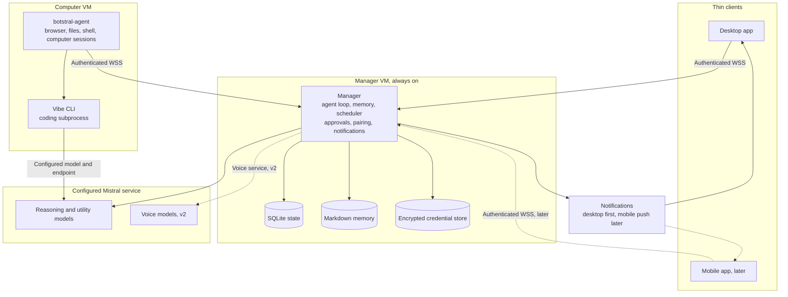

# Botstral design

Version v0.3. October 2026.

Status. Product design. M01 has a locally verified manager foundation. M02 has verified worker transport and logical session ownership across two separate virtual machines. [Two-VM acceptance](docs/m02-two-vm-acceptance.md) passed with isolated production and synthetic test fixtures. M03 has locally verified durable tasks, approval claims, Markdown source recovery and worker reconciliation. [M03 acceptance](docs/m03-acceptance.md) records the synthetic effect and cancellation scope. Real desktop execution remains a later milestone.

Author. Adam Nilsson. Personal, non-commercial project.

## 1. Goal

Build a self-hosted Grok Bot that uses Mistral-developed models instead of US models.

Match Grok Bot's personal features, including persistent bots, a shared computer, memory, skills, routines, connectors, approvals, files, and desktop and mobile access. The owner runs the application infrastructure. Mistral provides model inference through the configured service.

Build and validate the desktop experience first. Mobile apps follow after the desktop workflow is stable and are not required for the initial release.

The project is free and open source. Choose MIT or Apache 2.0 before publishing.

### Guiding principles

- Keep the Manager, task state, memory, credentials, and shared computer on infrastructure the owner controls.
- Use Mistral-developed models for reasoning, coding, helper tasks, vision, and supported speech features. Do not silently substitute models from another developer, including models hosted by Mistral.
- Prefer European infrastructure and explicitly configured European inference. Report the actual processing locations and service limitations.
- Preserve Grok Bot's personal capabilities as the product target. A working foundation does not establish feature parity.

## 2. Architecture overview

The diagram shows service dependencies. The voice media path remains to be selected under section 4.

### Core components

| Component | Responsibility |
| --- | --- |
| Manager | One always-on orchestrator owns bot sessions, durable task state, conversations, memory, schedules, event triggers, approvals, pairing, credentials, and notification dispatch. Clients and the worker connect to it. |
| Computer VM | The worker executes browser automation, file operations, shell commands, computer sessions, and Vibe coding jobs. It has no administrative access to the Manager or hypervisor. |
| Memory | Markdown files hold durable bot memory and owner instructions. A local SQLite index supports search. The index is rebuildable from the source files. |
| Clients | A full desktop application provides chat, activity, notifications, files, computer access, and approval controls. Mobile companions follow later using the same Manager protocol. Tasks continue when clients close. |
| Connectors | Model Context Protocol connections provide external tools. The Manager owns permissions and remote account tokens. Local connector processes run on the worker with only their required credentials. |

### Deployment and ownership

- Each installation serves one owner and their paired devices. Family accounts, organizations, public registration, and multi-tenant hosting are out of scope.
- One Manager VM and one Computer VM belong to that owner. Two separate VMs are required for the initial deployment. There is no combined installation mode.
- The split isolates browser and code execution from the credential store and approval authority. It also separates resource use and recovery procedures.
- Multiple bots per owner are part of the product target. Active work is limited by configured concurrency, memory, deadlines, and spending budgets.
- Each bot has its own conversation, instructions, memory, and computer session. Bots share files, installed tools, and deliberately shared browser logins under the configured guest account. This does not isolate bots from one another.
- Independent screens, correctly routed input, and manual takeover remain product requirements. Headless browser automation is an initial execution tool. It does not prove the complete shared-computer experience.
- Initial allocations are 8 gigabytes of memory for the Manager VM and 32 gigabytes for the Computer VM. These are planning budgets, not measured requirements.
- The reference deployment is Adam's 96-gigabyte Proxmox server. Both services must also support other compatible Linux hosts. The owner can use their own hardware or provision compatible European VMs.
- Hosted inference requires no local GPU. Optional local inference has separate hardware requirements and is outside the initial deployment.
- The Computer VM's software is replaceable, but user files and supported browser sessions are persistent state. Define backup and restore behavior before calling a rebuild or reset safe.

### Authentication and onboarding

Apps authenticate to the owner's Manager. Initial owner setup uses a dedicated local-only path. Remote routes and worker credentials cannot create the first owner.

M01 implements separate loopback setup and regular HTTP listeners, revocable local sessions, and an age-encrypted credential store. [The M01 architecture](docs/m01-architecture.md) records its actual interfaces and design reconciliation. [The recovery reference](docs/security.md) defines explicit unlock and no escrow.

The owner configures Mistral access through protected secret entry. The Manager stores provider credentials outside ordinary conversations and logs. Apps do not retain provider keys or retrieve stored vault values.

Mistral currently documents shared subscription usage across Vibe, Studio, and the API. Do not present subscription access and pay-as-you-go as incompatible APIs. Verify the selected key's scope, model access, usage limits, and region. Vibe's authentication and distribution permissions also require separate verification. See [subscriptions](https://docs.mistral.ai/admin/billing-usage/subscriptions) and [Vibe API keys](https://docs.mistral.ai/vibe/code/cli/api-keys-profiles).

### Durable execution

The Manager owns the task state machine. Tasks can be queued, running, awaiting approval, cancelling, completed, failed, cancelled, or awaiting attention. Terminal states record an outcome. Approval and attention states record what must happen before execution can continue.

- Persist the initiating request, bot, model configuration, tool calls, results, approvals, deadlines, budgets, and progress.
- Commit task transitions, outgoing commands, and corresponding events together in SQLite.
- Give every worker command a stable identifier. The worker journals accepted commands and their outcomes before acknowledging them.
- Repeated delivery of a command must reconnect to the existing execution or return its recorded outcome. It must not start replacement work blindly.
- Reconcile task state and the worker journal after a restart or reconnect. Keep external effects separate from transport acknowledgments.
- If an external action may have succeeded before a crash, reconcile it through a provider operation identifier or another reliable observation. If its outcome remains unknown, require attention before retrying.
- Cancellation remains pending until the worker confirms that the task and its process group stopped. Record effects that happened before cancellation.
- Enforce per-task turn, token, time, and spending limits across primary inference, helpers, and delegated coding. Recheck permission and budget before starting another operation.
- Give each computer session one input owner. Reject stale input after manual takeover or a task ownership change.
- Record scheduled runs durably. Define time zones, missed-run behavior, overlapping runs, and duplicate-trigger handling.

### State and recovery

SQLite is the source of truth for tasks, events, approvals, devices, and routine history. Markdown is the source of truth for memory and owner-authored instructions. The encrypted credential store has its own backup and unlock requirements.

The Manager serializes memory writes and records their source tasks. Model-generated memory is data, not permission to change security policy. Owner instructions and approval rules cannot be rewritten by retrieved content.

Backups must cover Manager state, memory, credentials, and durable artifacts consistently. Document which Computer VM files, browser sessions, and installed tools a backup preserves. Keep important deliverables in Manager storage. Test restoration before claiming recovery support.

## 3. Model routing

Use a configuration table per task role. Record the model identifier, developer, endpoint, supported capabilities, privacy policy, and usage limits. Verify availability against the configured endpoint before enabling a role.

| Task role | Candidate | Purpose and constraints |
| --- | --- | --- |
| Main reasoning and planning | Mistral Large 4, subject to preview policy | Multimodal reasoning and long-context tasks. Its preview status prevents treating it as an unconditional default for private data. |
| Utility reasoning | Mistral Small 4 | Summarization, classification, and routine evaluation where quality is sufficient. Policy enforcement remains deterministic Manager logic. |
| Alternative main model | Mistral Medium 3.5 | A configurable alternative when the required capabilities, region, and privacy terms are verified. Switching requires an explicit configured policy. |
| Coding | Vibe CLI on the Computer VM | Reuse its coding tools and resumable sessions. Pin its Mistral-developed model and endpoint, including utility models. |
| Vision | The selected vision-capable Mistral model | Screenshots and visual grounding. Verify capability separately from text inference. |
| Voice | Voxtral 3 with a configured Mistral reasoning model | Streaming transcription, reasoning, and speech generation. Planned for v2. |
| Document ingestion | Mistral OCR 4.1 | Text and image extraction where the selected region supports it. |
| Memory embeddings | Mistral Embed | Semantic retrieval over local memory. Evaluate Codestral Embed separately if code indexing is needed. |
| Optional safety classification | Mistral Moderation 2 or Shieldstral | Additional screening of untrusted content and proposed actions. Classification never grants permission or replaces approval rules. |

### Privacy, availability, and pricing

As checked on October 26, 2026, Mistral Large 4 is a public preview. Mistral's commercial terms permit training on preview inputs and outputs despite other opt-out settings. Do not route private data to preview models by default. Require explicit owner consent after disclosing those terms, or select a verified alternative. See the [ML4 documentation](https://docs.mistral.ai/models/mistral-large-4) and [commercial terms, sections 4.2 and 4.3](https://legal.mistral.ai/terms/commercial-terms-of-service/).

The listed ML4 price is $1.36 per million input tokens and $4.18 per million output tokens, before any regional surcharge. Treat prices as dated estimates. Maintain the configured price table and record actual usage. Pricing estimates alone cannot enforce a hard spending limit.

Mistral's European regional endpoint covers EU and EFTA countries. Account, billing, access-management, and other operational metadata may be handled outside the inference region. Verify stricter EU-only requirements separately. Do not infer legal immunity from the provider's nationality or the endpoint's name.

Regional endpoints currently exclude hosted Agents, Batch, and Files APIs. Run orchestration, storage, and scheduled inference calls in Botstral. Do not silently switch a scheduled job to global Batch to obtain a discount. Verify reasoning, vision, embeddings, OCR, moderation, and speech separately. See [regional inference](https://docs.mistral.ai/inference/regional-inference).

A missing model or regional capability produces a visible blocked state. Changing the model developer, provider, region, or privacy policy requires an explicit owner choice or a previously configured policy.

Optional local inference requires model-specific license, hardware, and quality checks. Do not equate an open-weight license with practical operation on the reference VMs. No local fallback is promised for v1.

## 4. Voice call mode

Voice is planned for v2. The proposed pipeline uses Voxtral Mini Transcribe Realtime 3 for streaming transcription, Mistral Small 4 for conversation, and Voxtral Mini TTS 3 for speech. Longer tasks enter the same durable task system as text requests. Results can return verbally or through the app.

### Delivery modes

1. In-app voice starts in the desktop app using WebRTC and LiveKit. Extend it to mobile after that client is available. Choose and document the media server, signaling, relay, authentication, and model endpoint before implementation.
2. Telephone calling can follow later through a supported provider such as Twilio or Telnyx. Verify geography, permissions, number availability, and all provider charges separately.

Hosted transcription and speech generation send audio or text to Mistral. Self-hosting the Manager does not keep that audio entirely on the owner's hardware. LiveKit hosting and media relays also need explicit deployment choices. Voice therefore adds media connections beyond the WSS control protocol.

Mistral's launch pricing quotes $0.04 per minute for its voice agent API with Small 4 and $0.08 with a larger model. These are estimates for that service. A separately assembled pipeline, regional processing, media hosting, or telephone provider can have different charges. See the [Voxtral 3 announcement](https://mistral.ai/news/voxtral-3/).

### Design rules

- Use the same bot identity, permissions, memory, and task history as text interactions.
- Offer transcript retention controls and make saved transcripts inspectable and deletable. Do not save every call to durable memory automatically.
- Voice requests follow existing approval rules. Sensitive actions require an authenticated in-app approval card unless an applicable owner rule already authorizes them.
- Support interruption and cancellation. Tasks may continue after a call ends when the owner has authorized continued work.
- Verify speech model access, licensing, region, languages, and audio permissions for each supported client before enabling the feature.

## 5. Security

### Credential vault

- Credentials are individual owner-created items. A login is one item. There is no automatic import of an entire password vault.
- Items are available to the owner's bots according to their usage policy. The shared Computer VM does not provide a security boundary between bots.
- Removing an item blocks future fills. Existing cookies, sessions, copied credentials, and remote grants require separate logout, invalidation, or rotation.
- Supported policy choices include approval for every fill and automatic fill on explicitly allowed origins. Uncertain page classification requires approval. A login approval never authorizes a purchase or another external action.
- TOTP seeds remain in the Manager. Generate only the current code for an approved fill. Require approval for every TOTP fill in v1.
- Store credentials encrypted on the Manager using an established implementation, such as age or SQLCipher. Choose the storage format and key-management scheme before implementation.
- Support explicit unlock state. A passphrase-protected store remains locked after reboot until unlocked. Automatic unlock requires an owner-provisioned key with a documented protection and recovery policy.
- Clients see item metadata and approval requests. They cannot retrieve stored secret values. Protected entry must avoid ordinary chat, logs, and analytics.
- Optional external password-manager integration can retrieve a single authorized item through a supported interface. Botstral's store is limited to credentials needed for agent work.

### Protected fill flow and limits

The worker requests a credential using the task, browser session, page, frame origin, and target fields. The Manager checks the item policy and obtains approval when required. The worker validates the destination again immediately before filling. A changed destination invalidates the request.

The Manager sends the approved value over the authenticated encrypted worker connection. The worker fills the field and avoids retaining the value outside the necessary browser state. Exclude secret values from ordinary prompts, screenshots, recordings, transcripts, logs, memory, and artifacts. Pause capture during protected entry and verify redaction with synthetic credentials before enabling supported sites.

These controls reduce accidental disclosure. They do not establish secrecy from arbitrary code with sufficient Computer VM privileges, a compromised browser, or the receiving website. A worker that receives a secret can retain it. Keep unrelated provider and connector credentials on the Manager where possible.

### Approvals and authorization

The Manager enforces permission rules before execution. Model moderation is optional screening and cannot authorize an operation.

- Bind an approval to the owner, bot, task, operation, normalized arguments, permission revision, expiry, and single-use execution identifier.
- Revalidate permission immediately before execution. Changed arguments or expired authority require a new decision.
- Include external sends, uploads, purchases, credential use, destructive file operations, and administrative changes in the action policy.
- Apply rules consistently to browser tools, connectors, shell execution, routines, and coding subprocesses.
- Document where arbitrary shell or browser access prevents enforcing a semantic action rule. Do not promise complete purchase or send prevention inside unrestricted guest execution.
- A worker may request approval but cannot grant it. Device revocation or a policy change invalidates affected pending authority.
- Preserve the exact proposed action and decision in the audit history without secret values.

Vibe documents programmatic execution, streaming output, limits, and session resumption. Programmatic mode denies tool calls that need interactive approval. Verify a supported approval integration before promising remote per-command approval. Do not enable blanket auto-approval to work around the missing interface. See [Vibe programmatic mode](https://docs.mistral.ai/vibe/code/cli/work-with-cli).

Prefer Manager-mediated inference for Vibe where compatible. Document any provider credential supplied to the subprocess and its exposure to guest code.

### General protections

- Treat websites, email, connector results, and generated files as untrusted input. A model's prompt-injection performance is not a security boundary.
- Restrict worker credentials to worker methods. They cannot approve actions, manage owner devices, export credentials, or change security policy.
- Keep Manager and hypervisor administration outside bot execution. Restrict the worker's network access to those systems to the required authenticated service.
- Audit tool discovery, permission decisions, execution, failures, and revocation. Set retention and redaction rules.
- Keep local connectors on the worker. Route remote connector operations through the Manager when this avoids exposing account tokens to guest code.
- Revoking a connector blocks new calls, including cached tool requests from bots and Vibe. Document the treatment of calls already in flight.

## 5a. Connectivity

- M05 serves owner devices and workers through one TLS listener with separate authority. Presented client certificates must pass worker trust. Worker paths require verified mutual TLS. Owner paths require a separately paired device credential and reject certificate-bearing requests. M01 owner administration and setup retain their loopback listeners. See [remote owner access](docs/remote-owner.md) and [the worker protocol](docs/worker-protocol.md).
- `botstral-link` defines shared protocol schemas and Rust and TypeScript bindings. Use established networking components for TLS and WebSockets. Model APIs, notifications, updates, and future voice media have their own connections.
- Owner clients save a random 256-bit credential before enrollment. An authenticated local owner independently confirms its fingerprint. The expiring, single-use invitation binds that fingerprint, Manager identity, and owner role. M05 uses long random invitations with durable attempt limits. Short-code interfaces remain outside M05.
- Pairing pins the exact Manager leaf alongside normal TLS chain, name, time, and signature verification. Replacement trust is exported through authenticated local administration and imported through protected client input with Manager identity checking. Failed connections never discard the pin.
- Issue separately revocable credentials for owner devices and workers. Authorize each method by role. Revocation closes existing connections and rejects reconnects.
- LAN access works directly. The remote endpoint stays configurable. M05 verified a temporary public bore v0.6.0 route with synthetic state. A durable deployment can use a self-hosted rathole raw TCP relay. There is no automatic reachability guarantee or permanent deployment in M05.
- Keep the encrypted client connection terminated at the Manager when a relay is used.
- Clients resume from their durable application cursor. M03 retains authoritative events and supplies a complete snapshot when history expires. M05 transfers snapshots and large replies in bounded, ordered, hashed chunks. The native client atomically installs authoritative state with its cursor and preserves the old cursor after interrupted recovery.
- Heartbeats detect dead peers. Reconnect with exponential backoff. Bound queues so slow clients do not block other clients or task execution.
- Notifications wake the client to fetch authoritative state. They are not the durable task or approval queue, and a notification alone cannot approve an action.
- Desktop uses native notifications driven by Manager events. Mobile push is later work. Self-hosted ntfy is a candidate, but instant iOS delivery still requires an APNs-connected upstream. Keep notification payloads minimal and document this external dependency. See [ntfy's iOS requirements](https://docs.ntfy.sh/config/#ios-instant-notifications).

## 5b. Daemon and Computer VM

The Rust `botstral-agent` daemon runs on the Computer VM and establishes an authenticated WSS connection to the Manager. It needs no public inbound worker port. SSH is reserved for bootstrap and recovery.

### TaskRunner contract

Commands cover starting work, querying status, requesting cancellation, resolving approved operations, and retrieving results. Every command carries a stable identifier and an owning task. Worker events include acceptance, progress, redacted logs, approval requests, screenshots, artifacts, completion, failure, and confirmed cancellation.

The durable execution rules in section 2 govern acknowledgments, duplicate delivery, and recovery. Event replay restores observations. It does not guarantee that an external effect happened exactly once.

### Responsibilities

- Supervise tasks, deadlines, subprocess groups, and browser sessions. A hang triggers diagnosis and reconciliation before any restart that could repeat an effect.
- Enforce global and per-bot resource admission. Set active browser and coding limits from measured workloads.
- Manage Vibe sessions with explicit task ownership, working directories, cancellation, and output capture.
- Preserve independent computer sessions and input ownership as the shared-computer experience is implemented.
- Stage artifacts and copy durable deliverables to Manager storage. Define transfer size limits and integrity checks.
- Negotiate protocol versions and capabilities. Unsupported combinations fail visibly before work begins.
- Follow the Manager's release channel. A stable Manager does not accept a nightly daemon. Apply only verified, compatible worker updates.

Provisioning and recovery operations require narrowly scoped owner-authorized adapters. Worker tasks do not receive hypervisor credentials or permission to rebuild their own host.

## 5c. Release model

- Maintain stable and nightly channels. A green merge to the main branch can produce a GitHub prerelease with version `X.Y.Z-nightly.<date>.<build>` and an OCI image tagged `nightly`.
- Stable releases manually promote a tested nightly commit. Generate notes against the preceding release in the same channel.
- Publish SHA256 checksums and authenticated release metadata. Checksums alone do not establish who published an artifact. Verify authenticity before installing updates.
- Provide an installation channel setting through `BOTSTRAL_CHANNEL`, separate app update feeds, and channel-pinned container tags. Record the installed version and image digest.
- Manager updates require an owner approval card. Stop admitting new work, drain active execution, back up persistent state, and verify migration compatibility before applying an update.
- Define recovery for a failed update and incompatible state migration. Do not terminate active tasks silently or assume that binary rollback reverses database changes.
- The daemon follows the Manager's channel and compatible protocol range. External supervisors or container tooling apply service updates.

## 5d. Technology stack

| Component | Choice | Reason and constraints |
| --- | --- | --- |
| Manager | Rust with tokio, axum, and rusqlite | An efficient always-on service with SQLite state. Binary size and memory use require measurement. |
| Daemon | Rust in the same workspace as the Manager | Shares protocol types and verification while remaining independently deployable. |
| Protocol | JSON over WSS with Rust and TypeScript libraries | A versioned contract shared by services and apps. |
| Desktop app | Tauri with React and TypeScript | A full desktop app with native notifications, tray integration, and approval controls. |
| Mobile app, later | React Native for iOS and Android | Reuses the TypeScript protocol library and selected application logic after the desktop workflow is stable. Native integrations and platform behavior need separate verification. |
| Browser automation | Playwright with Chromium on the worker | Package a supported Playwright runtime alongside the Rust daemon. The binding or subprocess interface remains to be selected. |
| Memory | Markdown with a local SQLite index | FTS5 provides text search. Add an explicitly selected vector index when semantic retrieval is implemented. SQLite alone does not select a vector-search implementation. |
| Voice | Voxtral 3 with LiveKit integration | A v2 candidate subject to model, media-path, privacy, and licensing checks. |
| Scheduler and triggers | Manager-owned execution and state | Durable routines use the same task and approval system as interactive work. |
| Packaging | OCI images for Docker or Podman and Linux service installation | Two separately deployable services with stable and nightly channels. |

The milestones in [PLAN.md](PLAN.md) follow these choices, including their durability, authorization, and feature-parity requirements. [README.md](README.md) summarizes the project and stack.

## 6. Naming and independence

Use the distinct name Botstral and an independent-project disclaimer. Do not imply affiliation with Mistral or Grok Bot, or use their logos without permission. Verify trademark requirements before public distribution.

Headless Vibe operation is documented, but distribution and integration rights are separate questions. Mistral's commercial terms restrict integrating Vibe into products offered to third parties unless authorized or otherwise permitted by the terms. Verify the terms that apply to this project's API and Vibe use before distribution. See [commercial terms, section 2.2](https://legal.mistral.ai/terms/commercial-terms-of-service/) and [consumer terms](https://legal.mistral.ai/terms/eu-consumers-terms-of-service/).

## 7. Roadmap

| Phase | Scope |
| --- | --- |
| First acceptance milestone | One owner, one bot, one worker, one complete desktop workflow, durable tasks, browser and file tools, one connector, and one scheduled routine. Prove restart, disconnection, approval, cancellation, uncertain-outcome handling, and restoration. |
| v1 | Agent loop, browser, filesystem, Vibe coding, initial connectors and routines, protected credentials, the desktop app, and the initial multi-bot roster. Keep the Manager and Computer VM separate from the start. |
| v1.x | Connector expansion, shared-computer sessions and manual takeover, approval experience, memory semantic search, skills, file retrieval, usage controls, and recovery. Deliver independent screens and shared login behavior before claiming those capabilities. |
| v2 | In-app voice with Voxtral and LiveKit, richer bot coordination, delegation, and handoffs. |
| Later | Mobile companions after the desktop workflow is stable, telephone calling, optional personal-computer access and traffic routing, and community contributions. |
| Public release | Select the open-source license, verify distribution rights, publish installation and recovery instructions, and demonstrate the implemented capabilities. |

The [feature-parity milestones](PLAN.md#feature-parity-milestones) remain the fuller product checklist. Skills, demonstration capture, editable memory, searchable results, bot management, and proactive work remain in scope. Service-specific capabilities require supported integrations. Do not claim an equivalent to a privileged Grok service feature until access and behavior are verified.

### Acceptance evidence

- Restart the Manager during active work and recover the original task without starting a duplicate execution.
- Disconnect the worker after an external action and before its result is recorded. Reconcile the outcome or request attention before another attempt.
- Disconnect a client beyond replay retention and restore its current state through a snapshot.
- Deny an approval, change its arguments, expire it, and revoke its device. Confirm that none of those cases authorizes stale work.
- Cancel a running browser or coding task and verify that its process group stops before reporting cancellation complete.
- Test protected entry with synthetic credentials and inspect model inputs, captures, logs, memory, and artifacts for disclosure.
- Verify that worker credentials cannot approve actions, enroll owner devices, or access unrelated credentials.
- Run a scheduled routine with clients closed and verify duplicate-trigger and restart behavior.
- Restore a backup and inspect bots, history, memory, credentials, and deliverables. Verify Computer VM state against its stated recovery policy.
- Before claiming shared-computer parity, verify two independent screens, shared files and supported logins, simultaneous input, and manual takeover without input crossing sessions.
- Verify the selected Mistral-developed model and endpoint on every managed inference path. Keep unsupported capability and privacy states visible.

## 8. Open questions

1. Which Mistral model and region satisfy the initial reasoning, vision, privacy, and usage requirements without relying on unapproved preview terms?
2. Which Vibe interface supports the required approval, cancellation, session, and usage behavior, and what integration rights apply to public distribution?
3. How will backup restoration and later credential policies extend M01's age store and explicit passphrase recovery policy?
4. Which Playwright runtime and Rust integration will be packaged, and how will protected capture and supported website fills be verified?
5. Which remote-access route and certificate lifecycle will desktop support first? Select mobile push delivery with the later mobile client.
6. How will independent desktop sessions, shared browser authentication, streaming, and manual takeover be implemented and verified?
7. Which speech endpoints, retention policies, LiveKit deployment, and licenses will voice use when v2 starts?
8. Which signing and migration-recovery mechanisms will protect updates, and which open-source license will the project publish under?
