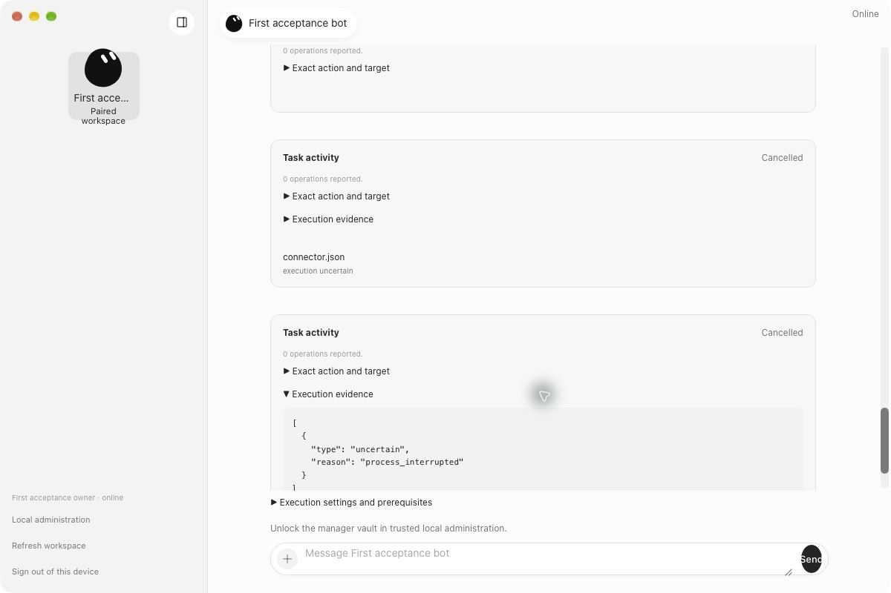
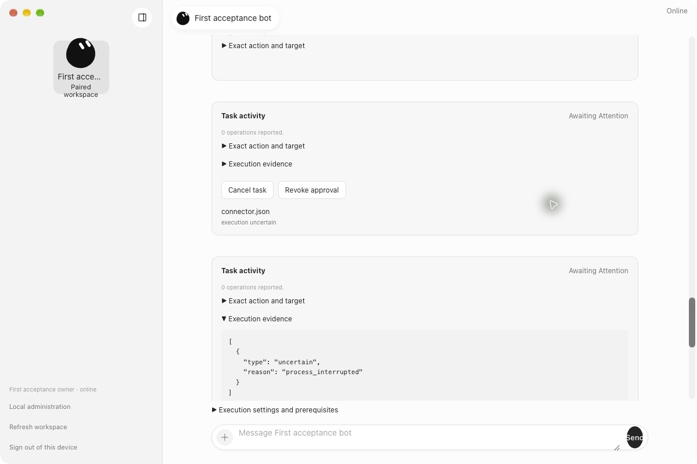

# Unresolved connector effects after shutdown

A stopped connector process does not prove whether its external effect completed. The manager now keeps the task awaiting attention when its connector ledger records an unknown outcome. It retains the original execution, stop proof, uncertainty evidence, and consumed approval. It rejects reapproval and redispatch.

The correction handles either ordering of the stop report and connector settlement. Startup also repairs saved cancelled tasks with unknown connector outcomes. Recovery, cancellation, approval revocation, permission revocation, parent cancellation, and bot deletion preserve the stop proof. A proven stop releases process occupancy for unrelated work. Ordinary confirmed cancellation remains cancelled.

The live reproduction paused the worker until its WebSocket disconnected after one external receipt, before completion was returned. Recovery retained one effect and the original execution. The native desktop showed the original task awaiting attention. Manager regression tests cover both event orders, reopening, duplicate reports, late results, owner actions, recovery, and parent cancellation.

## Desktop evidence

These captures show the same retained task before and after manager recovery. The desktop renderer is unchanged.

Before the correction, the unresolved task appeared cancelled.

After the correction, it requires attention.

